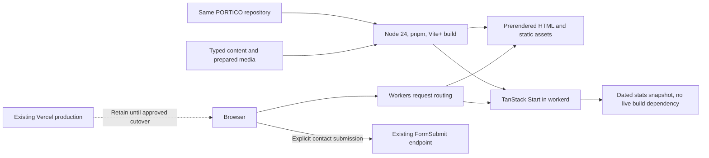

# PORTICO TanStack Start and Cloudflare Implementation Plan

> **For Claude:** REQUIRED SUB-SKILL: Use superpowers:executing-plans to implement this plan task-by-task.

**Goal:** Move PORTICO to TanStack Start and Cloudflare Workers while preserving its visual design, public behavior, repository history, and accepted portfolio content.

**Architecture:** Use React routes with typed local content and prepared media. Prerender the portfolio homepage and retain Workers SSR for unmatched routes and any retained HTTP endpoint. Use the direct Cloudflare Vite plugin with Workers Static Assets.

**Tech Stack:** TanStack Start, React, TypeScript, Tailwind 4, pnpm, Vite+ with Oxlint/Oxfmt/test tooling, Node 24 LTS for local and CI builds, and Cloudflare workerd for deployment.

---

This is a future implementation procedure. Every task and acceptance checkbox below is pending. The current authorization covers cloning and writing documentation only. Do not execute package installations, source changes, commits, PR actions, deployments, credential setup, or DNS changes from this plan without a later request.

> **Implementation status, 25 October 2026.** A later request authorized local and CI implementation, dependency installation, commits, pushing `feat/portico-tanstack-cloudflare`, and opening the implementation PR. It did not authorize deployments, DNS, credentials, or account changes. Tasks 1 to 13 are implemented on that branch; Tasks 14 and 15 are prepared as documents only. Evidence and deviations are in `docs/migration/`: [baseline](../migration/baseline.md), [content decisions](../migration/content-decisions.md), [toolchain proof](../migration/toolchain-proof.md), [validation](../migration/validation.md), [deployment](../migration/deployment.md), and [rollback](../migration/rollback.md). The text below is the original procedure, kept unchanged; where implementation differs, the migration documents record what was done and why.

Read [the dated research record](2026-10-25-portico-migration-research.md) for repository facts, PR SHAs, current primary sources, Fleet identity evidence, and skill provenance. The inspected checkout is `/data/agent/projects/PROJECT-PORTICO`, `main`, `58f8827934cbc9fefb77d1fb7e43bbdfb73a3df7`, on `personal-dev-01`. No application validation has run.

## Keep the agreed scope

Use the migration for deliberate learning and a reusable foundation for future builder projects. Next can run this portfolio. A framework limitation is not the reason for the change.

Preserve the current section order, styling, theme, public image/download URLs, and anchors during the first port. Incorporate accepted PR 12 content and fixes once. Keep content verification separate from technical migration.

Do not add a CMS, database, authentication, monorepo, guestbook, live visitor counters, or new blog section by default. Do not require KV, R2, or D1. Defer MDX until there are real articles or case studies. Avoid a preliminary Next 16 rewrite. If migration is delayed, handle production Next security patches separately under their own authorization.

Use Workers and Static Assets, not a new Pages project. The direct `@cloudflare/vite-plugin` path replaces the earlier Vercel/Nitro proposal. Keep existing Vercel production available until Cloudflare preview validation and a separately approved cutover. Spaceship remains registrar.

## Follow the target flow

The intended architecture is:



The implementation and test paths are:

```text
Production:
  GET / at Cloudflare Workers
    -> generated Static Assets routing
      -> prerendered homepage HTML from src/routes/index.tsx
        -> src/routes/__root.tsx document shell, HeadContent, Scripts
          -> existing components/sections/* reading src/content/*
            -> public/images/* and public/fonts/*
  GET an unknown path
    -> @tanstack/react-start/server-entry in workerd
      -> src/router.tsx and generated src/routeTree.gen.ts
        -> root not-found UI with HTTP 404
  Optional retained GET /api/leetcode-stats?username=nabobery
    -> src/routes/api/leetcode-stats.ts server.handlers.GET
      -> src/content/competitive-stats.ts dated snapshot
        -> bounded JSON response, unknown values remain unknown
  Contact submit
    -> components/sections/contact.tsx HTML POST
      -> existing FormSubmit endpoint
        -> provider success/error experience, delivery tested only with approval

Tests:
  pnpm test
    -> vite-plus/test against content and SEO helpers
      -> local fixtures and temporary asset manifest
        -> unique project IDs, real asset references, correct origin, unknown stats
  pnpm exec playwright test
    -> local Cloudflare-backed preview
      -> tests/e2e/portfolio.spec.ts and metadata.spec.ts
        -> rendered HTML, real 404, anchors, theme, keyboard, media failures
      -> stats/contact request interception
        -> isolated provider failure and form paths, no real message sent
```

Do not turn the homepage into a browser-only SPA. The first HTML response must contain the main content and metadata. Keep browser-only effects out of server evaluation and preserve stable initial markup.

## Task 1: Record the baseline and protect ongoing work

Depends on no other task. Read @using-superpowers, @writing-plans, and applicable instructions again at implementation time.

Files: create `docs/migration/baseline.md`. Read `app/page.tsx`, `app/layout.tsx`, `package.json`, `package-lock.json`, `.github/workflows/lint.yml`, and the research record.

1. Run `git status --short`, `git branch --show-current`, `git rev-parse HEAD`, and `git remote -v` from the exact VM checkout. Stop if another task owns changes or the repository identity differs.
2. Refresh main and PR metadata read-only using the Fleet helper. Record current heads and any change from this research.
3. Record every active section ID, public URL, local asset, external link, and form field. Include existing `home`, `about`, `experience`, `projects`, `tech-radar`, `competitive-stats`, and `contact` anchors.
4. Capture desktop and mobile screenshots from the approved baseline or existing deployment without submitting contact data. Record browser, viewport, date, and source SHA.
5. Once implementation is authorized, use an isolated branch/worktree following Fleet and project rules. Preserve the documentation files and unrelated changes. Do not reset another checkout.

Expected result: a revision-specific behavior inventory and screenshots. Baseline build and security status stay unverified until their own approved checks run.

## Task 2: Resolve PR content before editing shared arrays

Depends on Task 1.

Files: create `docs/migration/content-decisions.md`. Read PR 12 versions of `components/sections/{hero,about,experience,projects,tech-radar,contact,competitive-stats}.tsx`, `components/ui/{animated-text,sheet}.tsx`, `app/layout.tsx`, `app/robots.ts`, `app/sitemap.ts`, `package.json`, and `public/og-image.jpg`. Read PR 9's project record and PR 11's workflow diff.

1. Write a file-by-file checklist of PR 12 content and fixes to retain. Record the original head SHA. Do not blindly cherry-pick the Next shell or its lockfile.
2. Ask Avinash to confirm employment dates, current title, years-of-experience wording, and all quantified claims. Retain source attribution for factual claims. Omit or qualify unconfirmed claims before publication.
3. Resolve each of the five image mismatches in the research record. Require the correct screenshot or an honest text-only card. Do not relabel an unrelated screenshot.
4. Ask whether the redirect extension is featured or archived. Supply its real image or use a text-only record. Do not merge competing arrays from PRs 9 and 12.
5. Record PR 11 as CI work to rework or supersede. Record PR 12 and PR 9 disposition recommendations without closing, merging, or modifying either PR.

Expected result: one reviewed content source and a provenance checklist. Public copy remains blocked where facts are unconfirmed. Technical work can continue with neutral or existing verified copy.

## Task 3: Prove the dependency combination before the full port

Depends on Task 1. This task is the first installation/build work and needs a later implementation request.

Files: create future `docs/migration/toolchain-proof.md`, `vite.config.ts`, `wrangler.jsonc`, `.node-version`, `pnpm-lock.yaml`, `playwright.config.ts`, and configuration-only `pnpm-workspace.yaml` in an isolated compatibility experiment. Modify its `package.json`. Do not scaffold over the existing app.

1. Reopen the linked Start, Cloudflare, and Vite+ guides. Inspect the intended CLI's help before using template options. Record exact candidate versions and peer requirements.
2. Select a current patched Node 24.x release at least 24.11.0. Pin its exact patch in `.node-version` and CI. Pin an exact pnpm `packageManager` value. Do not replace the VM's global runtime merely for convenience.
3. Build the smallest Start root route, index route, and router using the direct Cloudflare plugin. Use the configuration seed below. Choose the exact Start, Router, React, Cloudflare plugin, Wrangler, Vite+, and test versions from actual registry metadata, not guessed compatibility.
4. For manual Vite+ setup, align `vite` to its matching `@voidzero-dev/vite-plus-core` alias and Vitest to the bundled version shown by `pnpm exec vp toolchain`. Follow the selected release's migration rules. Keep framework plugin imports on their upstream package identities.
5. Prove SSR in workerd, client hydration, a component HMR edit, a server-route edit, prerendered `/`, production build, and local preview. Request a missing path and require HTTP 404.
6. Save versions, exact commands, exit codes, output paths, and any compatibility limitation. If any check fails, stop the wholesale migration and resolve that combination first. Do not silently switch to Nitro, Pages, or a Node server.

The researched configuration seed is not a tested combination:

```ts
import { defineConfig } from 'vite-plus'
import { cloudflare } from '@cloudflare/vite-plugin'
import { tanstackStart } from '@tanstack/react-start/plugin/vite'
import react from '@vitejs/plugin-react'

export default defineConfig({
	plugins: [
		cloudflare({ viteEnvironment: { name: 'ssr' } }),
		tanstackStart({ prerender: { enabled: true } }),
		react(),
	],
	lint: { options: { typeAware: true, typeCheck: true } },
})
```

Use this minimal Wrangler seed only after checking the selected schema:

```jsonc
{
	"$schema": "node_modules/wrangler/config-schema.json",
	"name": "portico",
	"main": "@tanstack/react-start/server-entry",
	"compatibility_date": "2026-10-25",
	"compatibility_flags": ["nodejs_compat"],
	"observability": { "enabled": true }
}
```

`portico` is a proposed Worker name, not a verified available resource. Pin the date actually tested. The current runtime guide says Node compatibility is implicit at this date. The framework guide retains the explicit flag, which is valid but redundant. Record the selected behavior rather than treating the deployed runtime as Node 24. Do not add production routes or account credentials to this experiment. Inspect the plugin-generated build configuration before choosing asset paths.

Suggested future commands are `node --version`, `pnpm --version`, `pnpm exec vp toolchain`, `pnpm exec vp check`, `pnpm exec tsc --noEmit`, `pnpm exec vp test`, `pnpm exec vp build`, and `pnpm exec vp preview --host 127.0.0.1`. Expected outcomes are successful exits and the observed preview origin serving real HTML. These commands are planned, not run.

Gate A: do not start Task 4 until the complete combination is recorded and these checks pass. Carry the proven configuration, exact dependency pins, browser runner setup, and initial scripts into the authorized implementation workspace before Task 4. Define `check`, `typecheck`, `test`, `dev`, `preview`, and `build` at this point so later commands exist. Start with `build: vp build`, then add media and SEO generation when Tasks 8 and 11 create those scripts. Task 12 finalizes and audits this setup rather than introducing it for the first time.

## Task 4: Replace the root shell and homepage routing

Depends on Gate A and Task 2's content checklist.

Files: create `src/router.tsx`, `src/routes/__root.tsx`, `src/routes/index.tsx`, generated `src/routeTree.gen.ts`, and `tests/e2e/metadata.spec.ts`. Move `app/globals.css` to `src/styles/globals.css` and import it from the new root. Replace `app/layout.tsx` and `app/page.tsx` only after the new route works. Modify `tsconfig.json` and `vite.config.ts`.

1. Add a failing browser assertion that the initial HTML contains the title, an H1, the main navigation, and the seven active sections. Add a missing-path assertion for HTTP 404.
2. Run `pnpm exec playwright test tests/e2e/metadata.spec.ts`. Expect the new route checks to fail before the port.
3. Implement `getRouter` with the generated route tree. Register router types using the current Start guide. Use `HeadContent`, `Scripts`, and a document shell in `__root.tsx`.
4. Move the existing homepage composition into `index.tsx`. Preserve disabled sections as disabled. Retain the existing root `components`, `hooks`, and `lib` locations initially to reduce unrelated file churn.
5. Preserve `@/*` for those root imports. Use explicit imports for `src/content` or add one deliberate alias for it. Update JSX/module settings, generated-route types, Next plugin entries, and `.next` type includes.
6. Implement the root error and not-found experiences with correct response status. Run the targeted test and `pnpm exec tsc --noEmit`. Expect a successful exit and no Next types needed by the new shell.

Do not use a blanket client-only setting to hide hydration failures. Generated route-tree policy must be consistent between development, CI, and `.gitignore`.

## Task 5: Port navigation, theme, and fonts

Depends on Task 4.

Files: modify `components/layout/navbar.tsx`, `components/layout/footer.tsx`, `components/sections/hero.tsx`, `components/theme/theme-provider.tsx`, `components/theme/theme-toggle.tsx`, `src/routes/__root.tsx`, and `src/styles/globals.css`. Create licensed font assets under `public/fonts/` and `tests/e2e/portfolio.spec.ts`.

1. Add failing checks for hash navigation, mobile menu keyboard behavior, saved light/dark preference, and system theme. Inspect first paint and the browser console for hydration warnings.
2. Replace hash and external `next/link` uses with anchors. Use TanStack Router `Link` only for actual internal routes. Preserve `href`, hashes, download behavior, and accessible labels.
3. Replace `next/font` with self-hosted WOFF2 and `@font-face`. Preserve `--font-inter`, `--font-poppins`, and `--font-space` until a separately reviewed typography change. Load only used weights, use `font-display: swap`, and avoid font downloads during build.
4. Validate `next-themes` in Start before deciding to replace it. Keep one pre-paint initialization strategy and handle denied localStorage access. Use stable server markup and a mount guard only where theme-dependent controls need it.
5. Run the targeted browser tests in light, dark, and system modes at desktop and mobile widths. Expect no theme flash, duplicate initialization, focus trap failure, or hydration warning.

## Task 6: Keep Tailwind 4 and align the remaining configuration

Depends on Tasks 3 through 5.

Files: modify the stylesheet now at `src/styles/globals.css`, `tailwind.config.ts`, `postcss.config.js`, `components.json`, `tsconfig.json`, `vite.config.ts`, and `lib/styles.css` if referenced.

1. Record the existing theme tokens and responsive styles in a screenshot comparison. Add a visible token check in the browser test.
2. Update the stylesheet's `@config` path and Tailwind source discovery for both `src` and retained root components. Remove stale `#__next` assumptions.
3. Make Tailwind plugin imports ESM-safe. Convert PostCSS to ESM or use the supported Tailwind Vite integration and remove duplicate processing. Select one path after the compatibility proof.
4. Set `components.json` to `rsc: false`, update its CSS location, and preserve the component aliases. Do not regenerate or restyle the existing UI library.
5. Run `pnpm check`, `pnpm typecheck`, and `pnpm build`, then compare representative mobile and desktop sections. Expected result: the same design with all utilities and theme tokens present.

## Task 7: Extract one typed portfolio dataset

Depends on Task 2 and Task 4.

Files: create `src/content/profile.ts`, `src/content/experience.ts`, `src/content/projects.ts`, `src/content/projects.test.ts`, and `src/content/competitive-stats.ts`. Modify the existing Hero, About, Experience, Projects, TechRadar, and Contact components only where data moves.

1. Write failing tests for unique project IDs, allowed categories, valid local media paths, and featured selection. Use local fixtures rather than external network calls.
2. Define a small record shape and extract the accepted project data once:

```ts
export interface Project {
	id: string
	title: string
	description: string
	techStack: readonly string[]
	githubLink: string | null
	liveLink: string | null
	imageUrl: string | null
	category: readonly string[]
	featured: boolean
}
```

3. Extract verified profile and experience content without changing its meaning. Populate project records from the provenance checklist. Use `null` for absent media instead of an unrelated fallback image.
4. Keep the current category filtering behavior and render featured work intentionally. Archive additional projects only after Avinash's selection. Write case studies around problem, contribution, trade-off, and evidenced outcome if approved content exists.
5. Run `pnpm exec vp test src/content/projects.test.ts` and the projects browser test. Expect zero duplicate records, missing local files, or invented claims.

Keep typed records in Git. Add MDX and reusable article components only in a later writing task.

## Task 8: Replace Next image handling with prepared assets

Depends on Tasks 5 and 7.

Files: modify `components/sections/about.tsx`, `components/sections/projects.tsx`, and `components/sections/blog.tsx` if retained in typechecking. Create `components/ui/responsive-image.tsx`, `scripts/prepare-images.mjs`, `src/content/media.ts`, and `src/content/media.test.ts`. Add derivatives under `public/images/` while preserving old public files initially.

1. Add tests that each published image record has real files, width, height, alt text, and responsive variants. Test the text-only case.
2. Prepare WebP/AVIF variants at useful viewport widths from the correct source media. Use an approved build-time image tool. Record its exact version and commands. Never depend on a production image-transformation service for the first release.
3. Replace `next/image` with `<picture>` and `` carrying intrinsic dimensions, `srcSet`, and `sizes`. Lazy-load below-fold work. Prioritize only the actual above-fold image if measurement supports it.
4. Reuse PR 12's OG JPG. Keep its 1200 by 630 intent, verify actual dimensions, and remove no public image path until callers and redirects have been reviewed.
5. Run media tests and browser checks at mobile and desktop DPRs. Expect no broken requests or layout shifts caused by missing dimensions. Record transferred bytes against Task 1 rather than inventing a performance target.

## Task 9: Make competitive statistics bounded and independent

Depends on Tasks 4 and 7. Default to a dated snapshot. A live service is optional future scope.

Files: modify `components/sections/competitive-stats.tsx`. Create `src/content/competitive-stats.test.ts` and `src/routes/api/leetcode-stats.ts` if retaining the existing URL. Remove `app/api/leetcode-stats/route.ts` only after replacement validation.

1. Write failing tests for an unknown value, a dated known value, a single-provider failure, an invalid username, and a missing snapshot. Use synthetic fixtures with explicit test-only values.
2. Represent each platform independently with source URL, `updatedAt`, value or `null`, and availability. Obtain real values only from an authorized check and retain their observation date. Show unknown data honestly, never a fabricated zero.
3. Remove per-visitor Codeforces submission downloads and the shared error state. Render source links and last-updated text. Ensure upstream failure cannot hide other platforms or block homepage build.
4. Prefer preserving `/api/leetcode-stats` as a snapshot-backed compatibility endpoint if it remains a public contract. Accept only the owner username, use standard `Request`/`Response`, preserve a documented response shape, return 400 for invalid input, and return a sanitized unavailable response if no source-backed snapshot exists.
5. Test the HTTP endpoint and each card with intercepted failures. Run `pnpm exec vp test src/content/competitive-stats.test.ts`, the relevant browser test, and an offline `pnpm build`. Expect no live upstream dependency.

If Avinash later chooses live data, add a separate task for input/response schemas, bounded upstream calls, timeout/abort, explicit cache TTL and stale policy, sanitized errors, and abuse limits. A scheduled Worker with KV is an option only after that scope is approved. Do not create those resources now.

## Task 10: Preserve contact behavior and make effects SSR-safe

Depends on Tasks 4 and 5.

Files: modify `components/sections/contact.tsx`, `components/sections/hero.tsx`, `components/ui/cursor-ripple.tsx`, `components/ui/particle-canvas.tsx`, `components/ui/animated-text.tsx`, `components/ui/scroll-progress.tsx`, and `tests/e2e/portfolio.spec.ts`.

1. Add a failing contact test that intercepts FormSubmit and checks the existing POST field names, validation, and external success/error navigation. Never send a real test message automatically.
2. Preserve the current HTML form action and method unless a separately reviewed product change replaces them. Review CSP `form-action`, feedback, provider redirects, and any thank-you path. Do not invent a Next server-action migration.
3. Keep `window`, `document`, canvas, event listeners, and typed.js initialization inside client effects with cleanup. Render a meaningful static headline before typed text starts and when JavaScript is disabled.
4. Respect reduced motion for text, scroll, particles, spinners, and cursor effects. Disable or simplify cursor effects on touch/coarse pointers. Cap particle/DPR work and pause it when hidden or off-screen.
5. Run browser tests with JavaScript disabled and reduced motion enabled. Check effect cleanup across navigation and menu interactions. Expect readable content, usable contact links, and no hydration or runtime errors.
6. If delivery verification is requested later, agree on the test sender/recipient and handling first. Record whether the real message arrived. Mocked tests do not prove delivery.

## Task 11: Port SEO and preserve HTTP behavior

Depends on Tasks 2, 4, and 8.

Files: create `src/lib/site.ts`, `src/lib/site.test.ts`, `scripts/generate-seo.mjs`, generated `public/robots.txt`, generated `public/sitemap.xml`, and `public/_headers` where suitable for assets. Modify `src/routes/__root.tsx`, `src/routes/index.tsx`, `tests/e2e/metadata.spec.ts`, and `wrangler.jsonc`. Port PR 12 intent from `app/robots.ts` and `app/sitemap.ts`; do not retain Next metadata APIs.

1. Write failing assertions against raw response HTML for title, description, one canonical URL, OG/Twitter tags, absolute image URL, favicon, and safely serialized Person JSON-LD.
2. Use one explicit build environment and production origin source. Production origin becomes `https://nabobery.dev` only for the approved target configuration. Do not infer production from an arbitrary Host header.
3. Generate sitemap and robots from the same source. Include only actual public pages. Do not put hash anchors in the sitemap or fabricate last-modified dates. Escape `<` in serialized JSON-LD.
4. Build a preview variant with `noindex, nofollow` in HTML and `X-Robots-Tag` on both prerendered and Worker-generated responses. Use a disallowing preview robots file, and verify headers where Static Assets bypasses the Worker. Robots alone is not privacy protection.
5. Keep unknown paths as genuine 404 responses and missing media as 404 responses. Avoid SPA fallback that returns homepage 200 for everything. Preserve existing public paths, trailing-slash behavior, and hash targets.
6. Run `pnpm exec playwright test tests/e2e/metadata.spec.ts` against local production preview and the separately built preview variant. Expect consistent origin values and no preview URL in production sitemap or social metadata.

## Task 12: Make package scripts, hooks, and CI reproducible

Depends on Tasks 3 through 11.

Files: modify `package.json`, `pnpm-lock.yaml`, `pnpm-workspace.yaml`, `.node-version`, `.github/workflows/lint.yml`, `.husky/pre-commit`, `.gitignore`, and `README.md`. Remove `package-lock.json`, Next dependencies/configuration, `.eslintrc.json`, and obsolete formatting configuration only after replacements work. Update editor settings only if introduced or present.

1. Define non-mutating scripts for `check`, `typecheck`, `test`, `test:e2e`, `build`, `dev`, `preview`, and `cf-typegen`. Use local binaries. Retain `tsc --noEmit` until diagnostic parity is demonstrated.
2. Use the following intended script mapping, adjusted only for the tested toolchain. Add any SEO/media generation explicitly to build rather than relying on undocumented side effects:

```json
{
	"dev": "vp dev",
	"check": "vp check",
	"typecheck": "tsc --noEmit",
	"test": "vp test",
	"test:e2e": "playwright test",
	"build": "node scripts/prepare-images.mjs && node scripts/generate-seo.mjs && vp build",
	"preview": "vp preview",
	"cf-typegen": "wrangler types"
}
```

3. Convert the existing lockfile once and review the resolved dependencies. Keep only `pnpm-lock.yaml`. Include the direct `clsx` and Radix dependencies used by components, using PR 12's fixes as input. Verify there is one effective Vite core and one test runner.
4. Replace npm/Next lint in Husky and lint-staged. Keep one hook mechanism. Make developer fixes explicit commands, and keep CI checks non-mutating. Keep formatting-only churn separate from functional port changes.
5. Replace the lint-only workflow with read-only CI permissions, exact Node/pnpm pins, static checks, tests, build, and browser validation. Pin checkout/setup-vp to reviewed immutable SHAs or exact releases. Do not use setup-vp's obsolete `v1` tag.
6. Choose one install path. A concrete option is setup-vp with `run-install: false`, followed by `vp install --frozen-lockfile`, then `pnpm check`, `pnpm typecheck`, `pnpm test`, `pnpm build`, and `pnpm test:e2e`. Verify those inputs and frozen behavior for the exact action version. Do not run another install afterward.
7. Install only the browser/runtime dependencies required by the selected browser runner in its future CI job. Treat package install hooks and PR code as execution, so do not run untrusted PR programs on this enrolled personal VM.
8. Update README local commands, environment distinctions, asset/content workflow, preview instructions, and rollback links. Add ignores for actual `dist`, `.wrangler`, route-generation policy, test reports, and local secret files. Keep the test report as CI evidence.

Run `git diff --check` and the complete future CI command sequence from a clean installation. Expected result: no lockfile changes, no source mutation from checks, all required tests execute, and the production output builds. Do not treat historical PR checks as this gate.

## Task 13: Validate local production behavior

Depends on Task 12. No remote deployment is needed for this task.

Files: finalize `playwright.config.ts`, `tests/e2e/portfolio.spec.ts`, `tests/e2e/metadata.spec.ts`, and `docs/migration/validation.md`.

1. Configure Playwright to run against the Cloudflare-backed production preview on loopback. Record the actual URL and startup command. Do not publish a VM port.
2. Test raw HTML, no-JavaScript content, missing routes, media paths, metadata, sitemap, robots, and the optional stats endpoint.
3. Test narrow mobile, tablet, and desktop layouts. Use keyboard-only navigation through links, filters, theme toggle, menu, and form. Check focus visibility, menu dismissal, contrast, and target sizes.
4. Test light, dark, system theme, denied storage, reduced motion, failed images, failed provider responses, and blocked FormSubmit. Keep errors independent and actionable.
5. Record a performance comparison for LCP, CLS, transferred media, JavaScript size, and visible animation cost using the same baseline conditions. Agree on regression limits from measurements, not invented scores.
6. Save source SHA, version tuple, command, exit status, screenshots, console errors, and test report. Label skipped or blocked checks explicitly.

A representative future assertion is:

```ts
import { test, expect } from '@playwright/test'

test('preserves public navigation and returns real 404s', async ({ page, request }) => {
	await page.goto('/')
	for (const id of ['home', 'about', 'experience', 'projects', 'tech-radar', 'competitive-stats', 'contact']) {
		await expect(page.locator(`[id="${id}"]`)).toHaveCount(1)
	}
	expect((await request.get('/definitely-missing-portico-page')).status()).toBe(404)
})
```

Gate B requires all of the following:

- [ ] Toolchain proof and clean-install CI pass at one recorded SHA.
- [ ] Initial HTML contains portfolio content and complete metadata.
- [ ] Design, anchors, links, media, downloads, and 404 behavior meet the baseline.
- [ ] Theme, mobile, keyboard, reduced motion, and no-JavaScript checks pass.
- [ ] Stats are dated/source-backed or explicitly unknown, with independent errors.
- [ ] Contact mock paths pass. Real delivery remains separately evidenced or clearly unverified.
- [ ] All published experience claims and project screenshots are confirmed.

## Task 14: Validate a Cloudflare Preview after deployment approval

Depends on Gate B and explicit authorization to deploy a preview. This task is not authorized by the present documentation request.

Files: finalize `wrangler.jsonc` preview settings and `docs/migration/deployment.md`. Do not add credentials to Git or create them implicitly.

1. Verify the intended Cloudflare account, Worker name, existing resources, and available scoped access. If access is absent, stop deployment and report the needed human setup. Do not run a new login or token enrollment as an assumed plan step.
2. Build the preview variant with indexing protection. Check the selected project-local Wrangler supports the documented Worker Previews flow. The refreshed guide requires at least 4.135.0.
3. After approval, verify and use the documented command `pnpm exec wrangler preview --name portico-migration` if supported by the pinned version and reviewed generated configuration. Capture both the stable Preview URL and Unique Deployment URL. This command publishes a preview and must not be run during planning.
4. Verify served HTML, assets, headers, 404s, API paths, CSP/form navigation, and preview indexing protection at that exact deployment. Run the same browser suite against the authorized preview URL. Avoid real contact delivery without its approved test handling.
5. Record deployment identity, source SHA, build environment, test results, and errors. Keep Vercel production and production DNS unchanged.

Gate C: Avinash can inspect the Cloudflare preview, the validation record, confirmed content, and measured regressions before approving production work.

## Task 15: Prepare the production cutover and rollback for review

Depends on Gate C. Preparing the review document is distinct from executing the cutover.

Files: complete `docs/migration/deployment.md` and `docs/migration/rollback.md`. Add production routes or redirect configuration only in a separately authorized implementation change.

1. Inspect the current DNS zone, nameservers, apex/www records, TLS, email records, DNSSEC state, Vercel domains, and redirects read-only. Nothing in this plan claims those dashboards were verified.
2. Record the current Vercel deployment and how to restore it. Preserve DNS record values and provider settings without copying credentials. Confirm that Vercel can still serve the intended domain during rollback.
3. Prepare the exact domain change for `nabobery.dev` and the chosen www policy. Keep Spaceship as registrar. If nameserver delegation is required, preserve mail records and coordinate DNSSEC/DS changes deliberately. Do not assume nameserver changes are necessary until zone state is known.
4. Prepare the Custom Domain attachment and resolve existing CNAME conflicts. Include TLS readiness, a deliberate TTL approach, monitoring, and the approved change window. Custom Domain creation itself changes DNS.
5. Prepare path/query-preserving redirects from controlled old hosts. URL fragments stay in the browser, so retain the section IDs in page markup. Do not assume the old `avinashchangrani.vercel.app` hostname can be redirected without reviewing its Vercel project configuration.
6. Produce a reviewable cutover checklist and request separate approval for the concrete production deployment, domain/DNS changes, and redirects. Do not execute them because preview passed.

After that approval, the intended order is to build the production-origin variant, deploy the tested artifact using the verified `pnpm exec wrangler deploy` path, attach the approved Custom Domain, verify TLS/content/metadata, and then enable reviewed old-host redirects. The exact generated configuration and account target must be rechecked first. Record each operation before starting another.

Rollback triggers include persistent 5xx errors, missing media/routes, broken contact paths, wrong canonicals/indexing headers, or a material measured regression. Before changing DNS, a failed preview needs no production rollback because Vercel remains production. After cutover, restore the captured Vercel domain/DNS configuration and disable conflicting redirects, then verify TLS, homepage, anchors, assets, and contact paths. A Worker version rollback can restore a previously good Cloudflare version but does not reverse DNS or canonical changes. Retain both artifacts until the agreed observation period completes. Do not delete the Vercel project during migration.

Gate D remains pending until production behavior is checked and the rollback route is demonstrably available.

## Resolve these decisions at their gates

- Confirm employment dates, current role wording, metrics, and selected work before publication.
- Choose featured versus archive for the redirect extension and provide correct project screenshots.
- Confirm the snapshot default or separately scope a live stats service. Confirm last-updated dates and source values.
- Select and prove exact package versions, the current Node 24 patch, pnpm version, Worker name, compatibility date, and CI action pins at Gate A.
- Confirm the canonical apex/www policy, redirect ownership, and actual Cloudflare/DNS state before Gate D.
- Approve any real contact test, preview deployment, credentials setup, production deployment, and domain cutover separately.

Use @technical-writing, @documentation-writer, and @unslop to maintain these documents. Apply @cloudflare, @tanstack-start-best-practices, and @vite when implementing their boundaries. Follow current primary documentation when a skill example is older. Keep the requested scope above all suggested skill workflows. Do not interpret this plan's required execution sub-skill header as permission to implement now.
